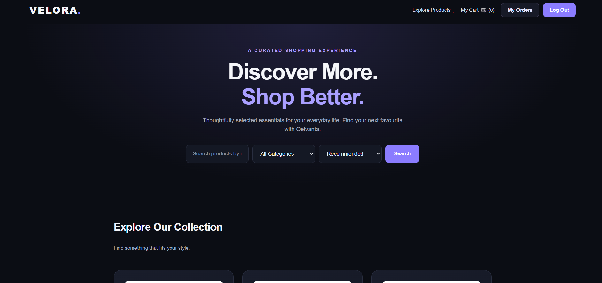
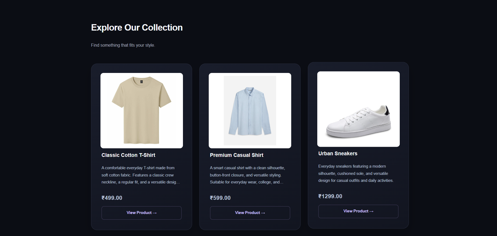
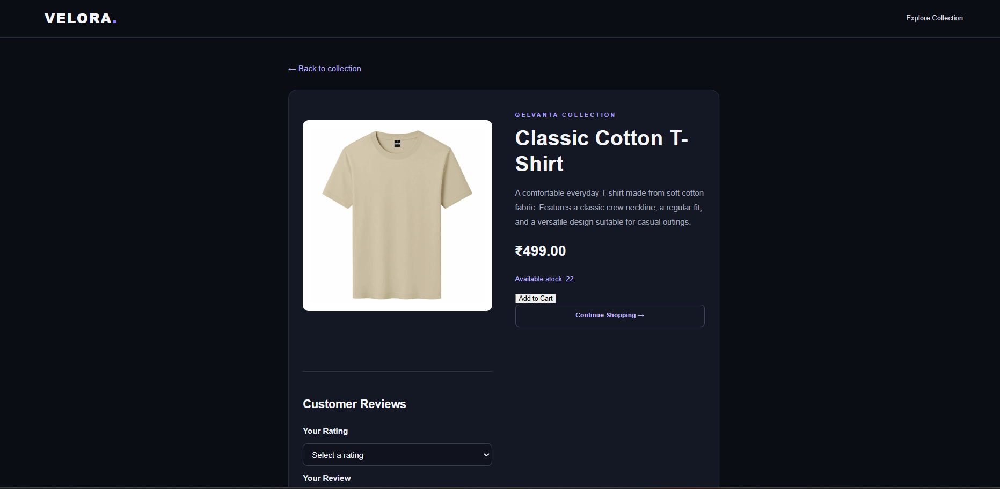
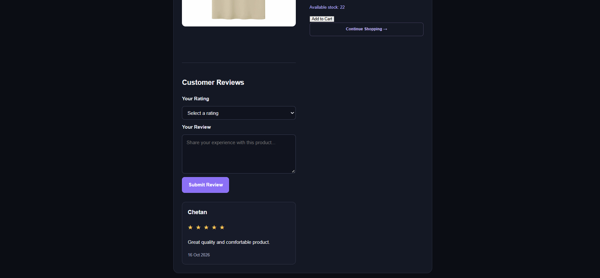
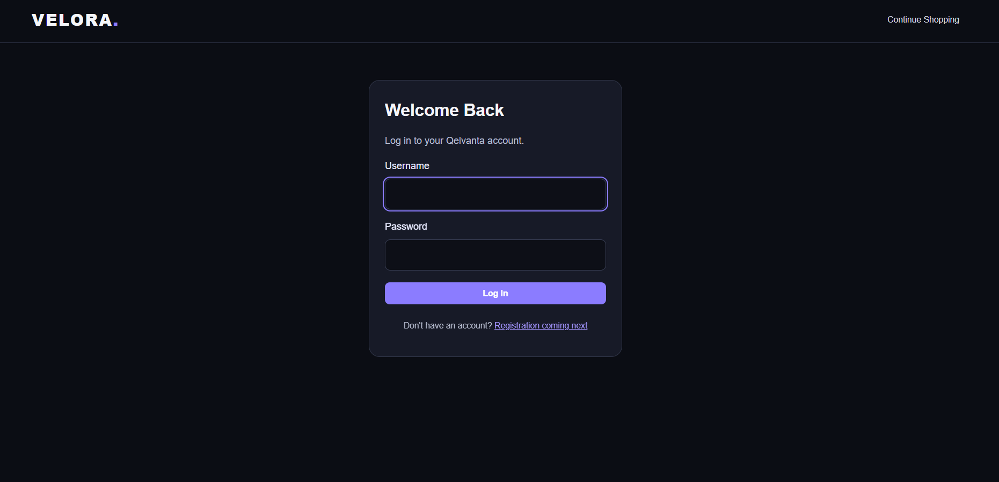
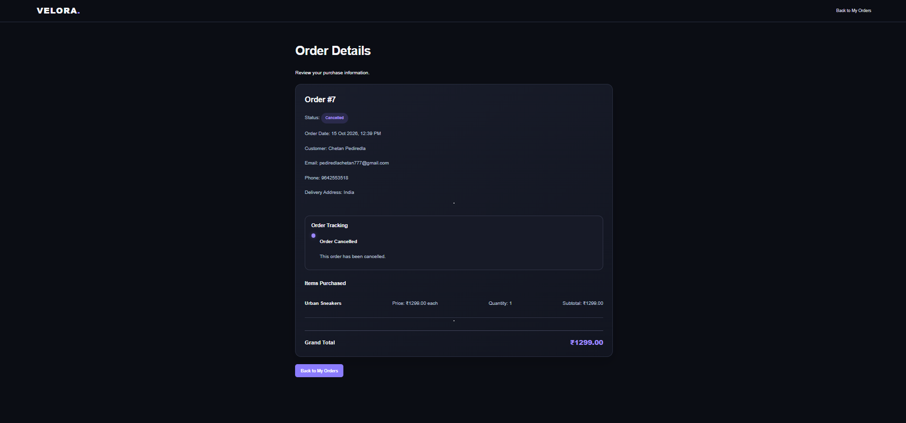

# VELORA — E-commerce Web Application

VELORA is a multi-category e-commerce web application built with Python and Django. It provides product discovery, customer accounts, shopping cart management, checkout, order tracking, and product reviews.

## Screenshots

### Homepage

### Product Listing

### Product Details

### Login Page

### Order Details

---

## Features

- Product listing, search, category filtering, sorting, and pagination
- Customer registration and authentication
- Shopping cart with quantity management
- Checkout and inventory updates
- Order history, order details, and order tracking
- Order cancellation with stock restoration
- Product reviews with 1–5 star ratings
- Django Admin for product and order management
- Customer-specific order access controls

## Technology Stack

- **Backend:** Python, Django
- **Frontend:** HTML, CSS
- **Database:** SQLite for development; PostgreSQL planned
- **Version Control:** Git and GitHub

## Local Setup

1. Clone the repository:

   `git clone https://github.com/pediredlachetan/velora-ecommerce.git`

2. Enter the project folder:

   `cd velora-ecommerce`

3. Create and activate a virtual environment:

   `python -m venv venv`

   Windows PowerShell:

   `.\venv\Scripts\Activate.ps1`

4. Install dependencies:

   `pip install Django python-dotenv`

5. Create a local `.env` file containing:

   `DJANGO_SECRET_KEY=your-local-secret-key`

6. Apply migrations:

   `python manage.py migrate`

7. Start the development server:

   `python manage.py runserver`

8. Open `http://127.0.0.1:8000/` in your browser.

## Security

Keep `.env`, database files, credentials, and production secret keys out of version control. Use a unique secret key for any deployed environment.

## Project Status

Completed as a portfolio project demonstrating Django web development, database management, user authentication, session-based shopping cart functionality, order processing, and product review features.

**Purpose:** To demonstrate practical Python and Django development skills for entry-level software engineering roles.
